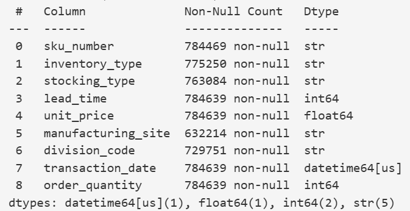
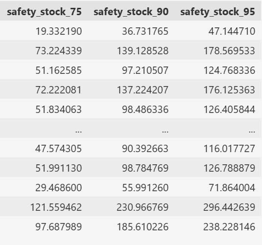

# OM 620 Assignments

[Click to view the project notebooks and data](https://github.com/kendrakershaw/OM-620-Assignments)

## Assignment 1
This focuses on the data cleaning and preparation of the transaction data. In Python I corrected column names, corrected data types, and missing values. I also engineered a country feature by extracting the country code from manufacturing site codes. 

**Important Findings:**

- Performed data cleaning and data preprocessing, corrected data types.

- Found 10 transactions with 2,800 day lead time and corrected it to 28 days, assuming it was a data-entry error.
- Corrected about 40,000 negative order quantities to positive values.
- Changed the remaining NA values to "Missing" using the lines of code below:\
`Transaction_ValuesMissing = ['sku_number','inventory_type', 'stocking_type', 'manufacturing_site', 'division_code'] 
transaction[Transaction_ValuesMissing] = transaction[Transaction_ValuesMissing].fillna("missing")`
- Created a column that tells us if the item is manufactured in the United States, Poland, Canada, or Japan.
- Identified we are working with 368 SKU's, 19 different manufacturing sites, 54 known divisions, and item BB9C0690 has the greatest demand.

## Assignment 2
This focuses on make to stock (MTS) items and calculating the safety stock for each SKU.

**Important Findings:**
- Calculated the service level coefficients for 75%, 90% and 95% with a standard normal distribution.\
`mts_z75 = stats.norm.ppf(.75)
mts_z90 = stats.norm.ppf(.90)
mts_z95 = stats.norm.ppf(.95)`
- Calculated the safety stock for each SKU at all 3 service levels. This is the code for 95% service level:
`mts_df["safety_stock_95"] = (
    mts_z95
    *mts_df["std_qty"]
    *mts_df["avg_lead_time"]** 0.5 
)`

- Identified which SKU's have highest and lowest safety stock, as well as the average.

This is the safety stock equation that was used:\
  **Safety Stock = Service Level Coefficients x Standard Deviation of Order Quantity x Square Root of Average Lead Time**
  
